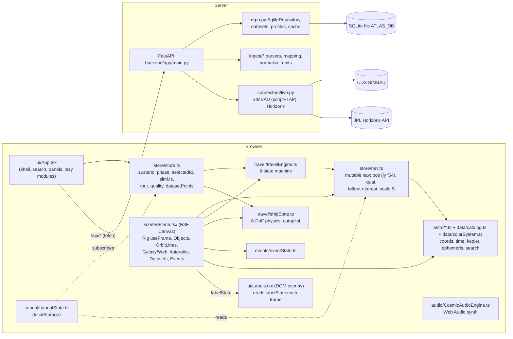
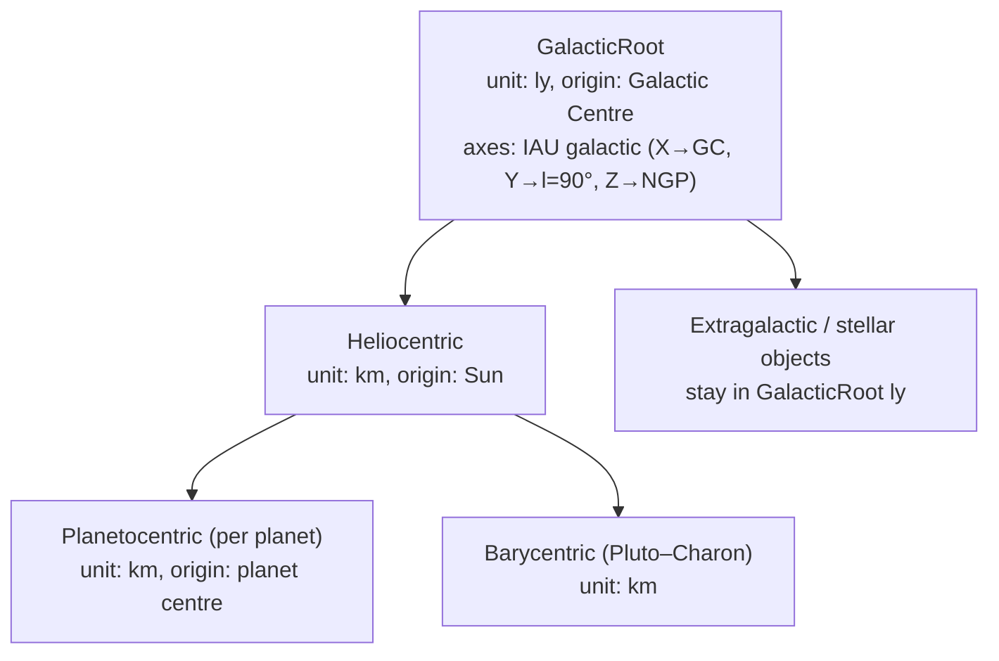
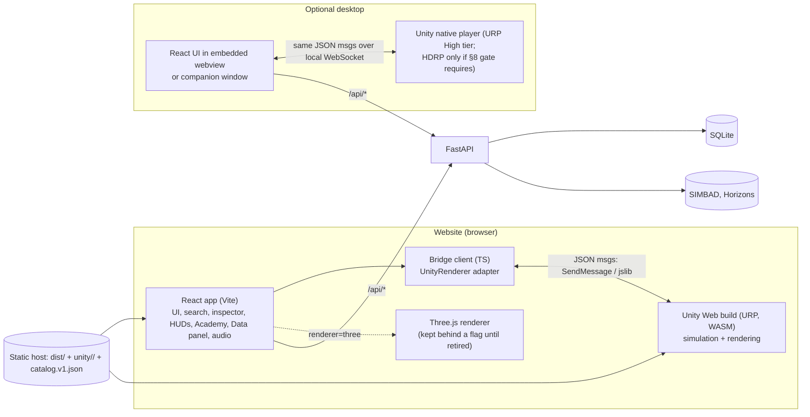

# Cosmic Atlas — Unity Migration Blueprint

**Status:** Audit and architecture phase. Nothing in the application was modified. No Unity project was created.
**Date:** 2026-11-08
**Branch inspected:** `planetary-realism` (HEAD `2552afa`) **plus uncommitted working-tree changes** in 7 source files (listed in §2).
**Decision requested:** approval of the recommendation in §12 and the first milestone in §13 before any implementation starts.

## How to read this document

Every claim carries an evidence tag:

| Tag | Meaning |
|---|---|
| **[F]** | Inspected fact: read directly in the source code, configs or docs of this repository. |
| **[M]** | Measured: a command was run during this audit and its output is quoted. |
| **[R]** | Recommendation or architectural proposal. Not implemented, not verified. |
| **[V]** | Unity/platform behaviour I believe to be true from documentation knowledge, but **not yet verified on this machine or project**. Each [V] item has a verification step in the roadmap. |

Nothing here claims Unity compatibility as verified. No Unity code has been written or run.

---

## 1. Executive summary

1. **[F]** Cosmic Atlas is a ~16,400-line TypeScript/React 18 + React Three Fiber 8 + Three.js 0.169 app with a ~870-line FastAPI backend. All 3D state is held outside React (`nav`, `ship`, `travelEngineState`, `eventState` mutable singletons) and driven by one `useFrame` rig. The astronomy core (`astro/*.ts`, `data/catalog.ts`, `data/solarSystem.ts`) is **pure, deterministic and framework-independent apart from one Three.js dependency in navigation**. That makes it the most portable part of the system.
2. **[M]** The existing suites pass: **frontend 96/96 tests (9 files), backend 12/12**. The README states two contradictory counts (77 and 21); both are stale.
3. **[F+M] The current "double-precision" root frame has a real precision ceiling.** All positions are float64 light-years with the origin at the Galactic Centre, and the Sun sits at x = −26,673 ly. At that magnitude one float64 ULP is **3.64 × 10⁻¹² ly = 34.4 km [M]**. Every camera and body position inside the Solar System is quantised to ~34 km steps before the camera-relative subtraction happens. The catalogue contains bodies smaller than that step (Deimos r = 6.2 km, Adrastea r = 8.2 km [F]), and Deimos' arrival view distance (3.5 r ≈ 22 km) is **smaller than one quantisation step**. This was derived from the code and IEEE-754, not reproduced visually. **A Unity port must not copy this single-root-frame design.** §6 proposes hierarchical frames.
4. **[R] Pipeline:** use **URP for both web and desktop** at first. HDRP cannot target the browser, and nothing in the realism requirements (atmospheric scattering, ring shadows, night lights, ocean glint) strictly needs HDRP, because at planetary scale these effects are best done analytically in custom shaders anyway. Build an **HDRP desktop renderer only if a measured URP desktop tier fails explicit acceptance criteria** (§8). If HDRP is needed, it must be a separate Unity project that consumes the same core packages, not a fork of the logic.
5. **[R] Ownership:** React stays the application shell and UI. Unity becomes a **rendering + real-time simulation component** controlled through a versioned JSON message protocol. FastAPI is unchanged. The TypeScript astronomy engine is **kept** in React for non-render calculations (search, inspector, NavMap distances). A C# port drives Unity. Both are locked together by shared parity fixtures.
6. **[R] Safest first milestone:** a **headless C# astronomy core with cross-language parity tests** (§13). It needs no rendering, no UI and no change to the existing app. It removes the largest technical risk (coordinate/ephemeris fidelity) before any visual work.

---

## 2. Scope of the inspection

**[F] Read in full or in the relevant parts:**
- `frontend/src`: `astro/*`, `store/*`, `data/catalog.ts`, `data/solarSystem.ts`, `data/tour.ts`, `data/assetRegistry.ts`, `scene/Scene.tsx` (rig, object loop, materials, lights, canvas), `scene/AsteroidBeltLayer.tsx`, `travel/*` (engine, ship physics, types, NavMap), `events/types.ts`, `events/eventState.ts`, `events/eventsCatalog.ts`, `tutorial/*`, `ui/api.ts`, `ui/App.tsx`, `ui/Shell.tsx` (exports), `ui/DataPanel.tsx` (visualise path), `ui/Labels.tsx`, `main.tsx`, `audio/CosmicAudioEngine.ts` (structure).
- `backend/app/*` (all modules), `backend/tests/test_ingest.py`, `render.yaml`, `README.md`, `docs/SOLAR_SYSTEM_VALIDATION.md`, `download_authentic_textures.py`.

**[M] Run during the audit:**
- `npx vitest run` → `Test Files 9 passed (9)`, `Tests 96 passed (96)`.
- `python -m pytest -q` with `ATLAS_DB` pointed at a scratch file → `12 passed`.
- A float64/float32 precision calculation (Python `math.ulp`, `numpy.spacing`), quoted in §6.2.

**[F] Uncommitted working-tree changes (audited as found, not authored by me):** `assetRegistry.ts` (+102), `Scene.tsx` (+446/−…), `labelState.ts`, `nav.ts`, `store.ts`, `travelEngine.ts`, `Labels.tsx`, plus modified and new texture files. Several add debug globals (`window.__nav`, `window.__store`, `window.__labelState`, `window.__scene`, `window.__camera`).

**Not inspected in depth:** individual event renderer shaders (`*Renderer.tsx`), `procedural.ts`/`textures.ts` internals, CSS, Python ingest internals beyond the API surface. Their migration cost is estimated, not measured.

---

## 3. Current architecture (inspected)



### 3.1 Subsystem findings

| Subsystem | Inspected facts |
|---|---|
| **Frontend stack** | **[F]** React 18.3.1, three 0.169.0, @react-three/fiber 8.17.10, drei 9.114.3, zustand 4.5.5, Vite 5.4, Vitest 2.1, TypeScript 5.6. No component-testing library, no browser E2E in the test suite. Python Playwright scripts in `scripts/` and the root `verify_*.py` files are run by hand. |
| **Component hierarchy** | **[F]** `main.tsx` → `App` (search, intro, quick jumps, `Boundary` → `CosmicCanvas`, `Labels`, `ScaleBreadcrumbs`, `TravelProgressHUD`, `Shell` exports `Browser`/`Info`/`TimeBar`/`StatusBar`/`Diagnostics`/`TourCard`). Lazily loaded behind `ModuleBoundary` + `Suspense`: `DataPanel`, `TravelHUD`, `CockpitOverlay`, `NavMapModal`, `CosmicEventsModal`, `EventPlayerHUD`, `WelcomeModal`, `TutorialOverlay`, `AcademyCompleteModal`, `HelpModal`, `AboutModal`. |
| **R3F integration** | **[F]** One `<Canvas>` (`Scene.tsx` `CosmicCanvas`): `logarithmicDepthBuffer: true`, ACES filmic tone mapping, exposure 1.1, fov 55, near 0.001, far 1e13, DPR by quality tier. The `Rig` `useFrame` advances sim time, runs the event/travel/explore branch, updates `nearest` and `nav.scale`, and pins the camera at the origin. Components read state imperatively (`useStore.getState()`, `nav`), not through React props, so per-frame work causes no React re-renders. |
| **State management** | **[F]** zustand store for UI-level state. Mutable module singletons for per-frame state: `nav`, `ship`, `travelEngineState` (with a listener set), `eventState` (listeners), `tutorialState` (listeners, persisted in `localStorage`), `labelState`. |
| **Camera & navigation** | **[F]** `nav.pos` (root-frame ly, f64) + `nav.quat` (Three.js quaternion). Modes: fly-to (log-lerp distance, eased, direction lerp), follow (translates with the moving target), orbit, free flight (WASD/QE/Space/C, shift ×6, speed ∝ nearest surface distance), pan, dolly clamped against the nearest surface. Any input calls `interrupt()`, which cancels travel and pauses the tour. |
| **Floating origin** | **[F]** The camera is always rendered at (0,0,0). Each object is placed at `toThree(P − cam) / S`. This is camera-relative rendering computed on the CPU in f64, then handed to the GPU as f32. |
| **Scale compression** | **[F]** `S = nearestSurface / 40` (`NEAR_UNITS`). Render distances above 10⁶ units are log-compressed (`compressDistance`) with angular size preserved. Minimum on-screen size is ~14 px (stars 0.6% of distance). The `lodFor` tiers exist and are tested but the renderer does not use them (README says so). |
| **Coordinate precision** | **[F]** Root frame = galactic Cartesian, ly, origin at the Galactic Centre, Sun at (−26,673, 0, 0). See §6.2 for the measured consequence. **[F]** `initShipNear` contains a comment acknowledging this ("keep the offset in Y/Z to maintain full float64 precision away from the large galactic X offset"). |
| **Keplerian engine** | **[F]** `astro/kepler.ts`: general two-body propagator (Newton plus a bisection fallback), secular Ω/ω precession, reference frames (ecliptic, pole-defined Laplace plane / planet equator), orbit polylines through the same math. `astro/ephemeris.ts`: JPL "Approximate Positions of the Planets" Table 1 (valid 1800–2050). `data/solarSystem.ts`: 54 bodies [M] (moons, dwarf planets, asteroids) from JPL SSD mean elements / SBDB with cited sources, IAU 2015 poles, Saturn ring radii. `satellitePhaseFit.ts`: Horizons-fitted phase corrections. Validation against a Horizons fixture is in `horizons.validation.test.ts`. |
| **Time engine** | **[F]** `simMs` = UTC milliseconds (JS number). The TT−UTC leap-second table runs to 2017. JD(TDB≈TT). Playback through `advanceSim(dt)` × `daysPerSec`. Deterministic and reversible (tested). |
| **Travel Mode** | **[F]** `shipState.ts`: 4 throttle gears (1,000 km/s → 800c), assisted/inertial flight models, stabilisation, cockpit/chase/external cameras, autopilot (align → accelerate → cruise → decelerate → arrive), proximity limits. 14 unit tests. |
| **Search & catalogue** | **[F]** `catalog.ts`: 17 hand-curated objects + 8 planets + 54 solar bodies = **79 bundled objects** [M] (counted by importing `OBJECTS`/`SOLAR_BODIES` in a scratch Vitest run). Scored search over name/id/aliases. `registerObject` adds live SIMBAD results at runtime, never overwriting. Relations kept separate: `parents`, `memberOf`, `nearby`. |
| **Object Inspector** | **[F]** `Shell.tsx` `Info`: type, aliases, distance ± uncertainty + basis, RA/Dec, l/b, extent, relations, provenance, confidence, links, and a Horizons comparison through the API. |
| **NavMap & autopilot** | **[F]** `NavMapModal.tsx` builds the destination list from `OBJECTS` (Sun, planets, moons, dwarf planets, asteroids), with filters by category/parent, distance and bearing from `ship.pos`, then calls `engageAutopilot`. |
| **Cosmic Events** | **[F]** 4 definitions (`supernova-betelgeuse`, `pulsar-crab`, `black-hole-m87`, `nebula-carina`) with staged timelines and a provenance enum (`measured` / `model-based` / `illustrative` / `hypothetical-simulation`). While an event is active, the rig switches to a separate orbit camera around the origin and hides normal objects. Each event has a bespoke R3F renderer (`*Renderer.tsx`, 211–321 lines each). |
| **Cosmic Academy** | **[F]** 8 missions. Completion is detected by: (1) `window` pointer/wheel/key listeners, (2–3) zustand subscriptions on `selectedId`/`rightOpen`, (4) **polling `nav.pos` / `nav.followId` every 400 ms**, and further missions use store/event state. Progress is persisted in `localStorage`. |
| **Dataset visualisation** | **[F]** `DataPanel` → `api.points` → `raDecDistToRoot` → `store.datasetPoints` → `DatasetLayer`. That layer places one group at the camera-relative origin and scales by `1/S`; points are absolute f32 inside the group (the README notes jitter at sub-AU zoom). |
| **External APIs** | **[F]** SIMBAD name resolver (sim-script) + TAP (sync ADQL) and JPL Horizons `horizons.api`, called via `httpx` with explicit timeouts. Failures map to HTTP 502. Optional Anthropic LLM for unmapped dataset columns (`ANTHROPIC_API_KEY`). |
| **Database & caching** | **[F]** SQLite (`ATLAS_DB`) with tables `datasets`, `profiles`, `cache`. Cache TTL is 1 day for SIMBAD and 7 days for Horizons. Behind a `Repository` Protocol ("SQLite now, PostgreSQL later"). On Render's free plan the disk is ephemeral (`render.yaml` comment). |
| **Deployment** | **[F]** Render Blueprint: a static site (Vite `dist/`) with `/api/*` rewritten to a Dockerised FastAPI service. Docker Compose + nginx locally. |

---

## 4. Defects and inconsistencies found during the audit

These matter for the migration because they determine what the "reference behaviour" is that Unity must match.

| ID | Finding | Evidence | Why it matters for Unity |
|---|---|---|---|
| D1 | Solar-System positions are quantised to ~34 km in the galactic-centre f64 root frame; smaller than some bodies and smaller than Deimos' view distance. | [F] `coords.ts` SUN_POS; [M] ULP calculation §6.2 | Unity must not reproduce it, and parity tests must compare **heliocentric/planetocentric km**, not root-frame ly, or they will inherit the error. |
| D2 | Axial orientations are **hard-coded render-frame Euler angles** (Earth `[0,0,0.409]`, Uranus `[1.706,0,0]`, Neptune `[0.494,0,0]`; generic fallback `uranus ? π/2 : 0.2`), while IAU 2015 poles exist in `PLANET_POLES` but are not used for planet spin axes. Planet spin rates are placeholders (`earth 1, jupiter 2.4, else 0.1` rev/day). | [F] `Scene.tsx` ObjectVisual and the `spin` loop; `solarSystem.ts` PLANET_POLES | "Correct axial orientation" (e.g. Uranus) needs pole-derived orientation plus IAU rotation models (W₀, Ẇ). The Unity port should derive these from data, not copy the constants. |
| D3 | The two `lookAtQuat` helpers now use **opposite argument orders**: the working tree changed `nav.ts` to `lookAt(to, from)` while `travelEngine.ts` still uses `lookAt(from, to)`. For the same inputs they yield opposite orientations, which affects `setCameraAt` (intro camera) and `nav.flyTo`. | [F] `git diff frontend/src/store/nav.ts` | It must be resolved and visually checked **before** capturing the Three.js golden baseline (Phase 0); otherwise the baseline may encode a bug. Not reproduced visually in this audit. |
| D4 | Texture provenance conflict: `assetRegistry.ts` (and a unit test asserting "public domain licensing") labels planet maps "NASA … Public Domain". The working-tree download script fetches most of them from **Wikimedia "Solarsystemscope texture 2k …" files**, plus `earth_specular`/`earth_normal` from the three.js examples repo and the Saturn ring colour from `threex.planets`. Solar System Scope maps are, to my knowledge, CC BY 4.0 and derived from NASA data, not NASA originals **[V]**. | [F] `download_authentic_textures.py` lines 19–37; `assetRegistry.test.ts` | Unity assets need correct licence metadata from day one; attribution may be required. The asset pipeline must record the true upstream source. |
| D5 | README is internally inconsistent: two test totals (77 vs 21; measured 96) and "planet sizes exaggerated" versus code that now uses true radii (`displayRadiusAU = rKm / KM_PER_AU`) except for the Sun (≈10.75× via `0.05 AU`). | [F] README, `catalog.ts`; [M] vitest | The Unity acceptance criteria must be written against the code, not the README. |
| D6 | Three different `KM_TO_LY` constants: derived `LY_PER_AU/KM_PER_AU` (`catalog.ts`), literal `1.057000834e-13` (`shipState.ts`, `NavMapModal.tsx`), and `1/9.4607304725808e12` (`AsteroidBeltLayer.tsx`). | [F] | The C# port should have exactly one constants table. Parity fixtures must note which constant each TS function used. |
| D7 | Debug globals on `window` (`__nav`, `__store`, `__labelState`, `__scene`, `__camera`) in uncommitted changes. | [F] git diff | Not a migration blocker. They should not be relied on as an integration surface for the Unity bridge. |
| D9 | *(found during Milestone 1)* Tethys' derived mean motion is negative (−6.23°/day): the JPL apsidal period used (0.005 yr) gives ω̇ ≈ 197°/day, faster than the orbit. Positions are unaffected (e ≈ 0.001), but `periodDays()` = −57.8 d is shown in the Inspector ("Orbital period: −57.789 d") and drives Tethys' synchronous spin. | [M] TS `validateElements(tethys)` → `["mean motion must be > 0"]`; catalogue export `props["Orbital period"]` | The port reproduces it faithfully; it is tracked as a known upstream defect in the C# tests. Fix the data in the app (separate change), then re-export. |
| D8 | The Academy's mission detection reads renderer internals (`nav.pos`, `nav.followId`) and `window` input events. | [F] `TutorialOverlay.tsx` | Once Unity owns the camera these must become explicit protocol events (§7.4). Window keyboard events may also be swallowed by the Unity canvas **[V]**. |

---

## 5. Feature migration matrix

Complexity: **L** low, **M** medium, **H** high. Home: where the feature lives after migration. **R** = React, **U** = Unity, **API** = FastAPI.

| # | Feature | Current implementation / files | Dependencies | Data in → out | Existing tests [F/M] | Unity equivalent [R] | Cx | Risks | Home |
|---|---|---|---|---|---|---|---|---|---|
| 1 | Multi-scale renderer, floating origin, compression | `scene/Scene.tsx` (`Rig`, `Objects`), `astro/scale.ts` | three, R3F, `nav`, catalog | catalog positions, `simMs`, camera → GPU transforms | 3 scale/LOD tests (`astro.test.ts`) | `WorldRenderer`: per-frame C# loop writing `Transform.localPosition` from f64 camera-relative values; hierarchical frames (§6) | H | Depth precision without log depth; float32 Transforms | U |
| 2 | Planet/body visuals (Earth day/night/clouds/specular, Saturn rings, atmospheres, irregular moons) | `Scene.tsx` `ObjectVisual`, `AtmosphereMesh`, `getIrregularGeometry`, `getSaturnRingGeometry`; `scene/textures.ts`; `data/assetRegistry.ts` | textures (2K), custom GLSL | asset registry + body data → meshes/materials | 4 (`assetRegistry.test.ts`; one asserts a licence claim, see D4) | URP Shader Graph / HLSL `PlanetSurface`, `AtmosphereShell`, `RingSystem` materials; data-driven per body | H | URP realism ceiling (§8); texture licensing (D4); web memory budget | U |
| 3 | Milky Way, cosmic web, backdrop stars, galaxy/nebula sprites | `Scene.tsx` `GalaxyAndWeb`, `Backdrop`; `scene/procedural.ts`, `textures.ts` | procedural generators | seeds → point clouds/sprites | none | Procedural mesh/point generation in C# (same seeds), additive point shader | M | Visual drift from the procedural original; no tests to anchor it | U |
| 4 | Orbit lines | `Scene.tsx` `OrbitLines`; `kepler.orbitPathKm`, `ephemeris.orbitPolylineLy` | Kepler engine | elements, time → polylines | "drawn orbit passes through the body" (`horizons.validation.test.ts`) + orbit tests in `orbitalMechanics.test.ts` | Camera-relative line meshes rebuilt per frame in the parent body's frame | M | Line width/AA on WebGL; precision near the body (solved by frames) | U |
| 5 | Asteroid belt (10,842 SBDB rows) | `scene/AsteroidBeltLayer.tsx` + `public/assets/astronomy/data/main_belt_sbdb_h13.5.json`; Kepler solved in the **vertex shader** (4 Newton iterations) | GLSL | elements + JD → points | none | HLSL vertex-shader port (**no compute shaders on WebGL2 [V]**) | M | Float32 GPU precision is acceptable for dots; must stay vertex-shader based for web | U |
| 6 | Dataset point layer | `Scene.tsx` `DatasetLayer`; `store.datasetPoints`; `DataPanel.visualize` | API `/points` | RA/Dec/dist → points | backend `test_api_end_to_end_profile_reuse` etc. | Chunked point meshes, each with its own f64 origin (removes the f32 jitter noted in the README) | M | Up to 50k (API max 200k) points per message across the bridge | U render, R data |
| 7 | Labels | `ui/Labels.tsx` + `scene/labelState.ts` (DOM overlay, occlusion test against planet discs, priority) | per-frame projected positions | items → DOM | none | **Unity-side labels** (UI Toolkit or TextMeshPro) using the same visibility/priority rules; React only for selected-object callouts | M | Per-frame label streams over the bridge are too chatty; text quality on web | U |
| 8 | Picking & selection | `Scene.tsx` invisible hit meshes + `onClick`/`onDoubleClick` | R3F raycast | pointer → `select(id)` / `travel(id)` | none | **Analytic angular picking** in C# (projected centre + max(true angular radius, 14 px)) from f64 data, not PhysX colliders | M | Ambiguity in crowded fields; touch | U → emits to R |
| 9 | Explore controls | `scene/Controls.tsx`, `nav.stepNavigation` | DOM events | input → nav | 2 (`flyTo`, interrupt/resume) | Unity Input System + C# `NavigationController` port | M | Keyboard focus between the React DOM and the Unity canvas **[V]** | U |
| 10 | Coordinates & floating origin | `astro/coords.ts`, `store/nav.ts` | — | — | 6 coordinate tests | `CosmicAtlas.Astro` C# core with hierarchical frames (§6.3) | H | Handedness/axis conversion bugs (§6.4) | U (TS kept for R) |
| 11 | Ephemeris & Kepler engine | `astro/kepler.ts`, `ephemeris.ts`, `time.ts`, `data/solarSystem.ts`, `satellitePhaseFit.ts` | — | elements + t → positions | 4 ephemeris + 12 orbital-mechanics + 3 Horizons-fixture tests | C# port, **bit-for-bit algorithm parity**, verified by fixtures exported from the TS engine | M | Silent numeric divergence; data duplication (solved by JSON export) | U + R |
| 12 | Simulation time | `store.simMs/playing/daysPerSec`, `advanceSim`, `Shell.TimeBar`, `astro/time.ts` | — | UI controls → simMs | determinism/reversibility tests | `SimClock` in Unity is the authority while running; React `TimeBar` sends commands and shows snapshots | M | Two clocks drifting; React re-render rate | U authority, R UI |
| 13 | Travel engine (fly-to state machine) | `travel/travelEngine.ts`, `TravelProgressHUD.tsx` | nav, catalog, audio | target id → camera path, telemetry | 6 (`travelEngine.test.ts`) | C# `TravelEngine` with the identical state names and telemetry fields | M | Timers (`setTimeout`) become frame-time based; behaviour must stay equivalent | U, HUD R |
| 14 | Travel Mode spacecraft | `travel/shipState.ts`, `travelControls.ts`, `TravelHUD.tsx`, `CockpitOverlay.tsx`, `SpacecraftModel.tsx`, `WarpEffect.tsx` | nav, catalog | input → ship state, telemetry | 14 (`travel.test.ts`) | C# `ShipSimulation` + Unity model/VFX; HUD/cockpit stay React, fed by 10–20 Hz telemetry | H | HUD latency; cockpit overlay alignment with 3D | U + R |
| 15 | NavMap & autopilot | `travel/NavMapModal.tsx`, `engageAutopilot` | catalog, ship | ship pos → list; selection → autopilot | 4 autopilot tests (within `travel.test.ts`) | React modal (positions from the TS engine); `autopilot.engage` command to Unity | M | List distances must use the same ship position as Unity (snapshot) | R UI, U exec |
| 16 | Search & catalogue browser | `catalog.searchObjects`, `App` Search, `Shell.Browser` | — | query → objects | 5 catalogue tests | Unchanged in React; Unity receives catalogue JSON + `catalog.register` messages | L | Divergent catalogues (solved by one export) | R |
| 17 | Live SIMBAD / Horizons | `App.liveSearch` → `registerObject`; `Info` compare; `connectors/live.py` | httpx, external services | name/date → object/vector | `test_connector_parsers_offline` (offline only) | Unchanged; React forwards new objects to Unity | L | Live services are not covered by CI | API + R |
| 18 | Object Inspector | `Shell.Info` | catalog, api | selected id → panel | none | Unchanged React; live distance from the Unity snapshot | L | — | R |
| 19 | Scale breadcrumbs / frame labels | `ui/ScaleBreadcrumbs.tsx`, `nav.referenceFrameLabel`, `exampleScaleLabel` | nav | camera → labels | none | React, fed by `camera.state` telemetry (frame, scale) | L | — | R |
| 20 | FIND HOME tour | `data/tour.ts` (23 steps), `store.runStep`/pause/resume/skip | travel engine, timers | step → travel → dwell | tour order + interrupt/resume tests | React orchestrates; Unity executes `travel.start` and emits `travel.arrived` / `nav.interrupted` | M | Async round trips; interruption races | R orchestration, U exec |
| 21 | Cosmic Events | `events/*` (4 renderers, HUD, modal, state, catalogue) | custom shaders | event id → timed simulation | 12 (`events.test.ts`) | One Unity scene/prefab per event; `EventDirector` owns the timeline; HUD/modal in React | H | Four bespoke shader effects to rebuild; the scientific labelling must be preserved | U + R |
| 22 | Cosmic Academy | `tutorial/*` | store, nav, window events | interactions → mission completion | 17 (`tutorial.test.ts`) | React unchanged except the detection hooks, which subscribe to bridge events (D8) | M | Behaviour change if events are missed | R |
| 23 | Audio | `audio/*` (Web Audio synthesis, 679 lines) | Web Audio API | events → sound | 7 (`audio.test.ts`) | **Web:** keep in React. **Desktop native:** needs a port (Unity audio / DSP) or a webview host | M (web L) | Desktop parity | R (web) |
| 24 | Data Intelligence | `ui/DataPanel.tsx` + `backend/app/ingest/*` | FastAPI, SQLite | file → records/points | 12 backend tests | Unchanged; visualisation through feature 6 | L | — | R + API |
| 25 | Quality tiers, diagnostics, WebGL loss | `store.quality`, `GLWatch`, `Diagnostics` | — | — | none | Unity Quality levels mapped to `high`/`balanced`/`performance`; `renderer.stats` / `renderer.error` events | M | Different failure modes (WASM memory, context loss) | U + R |
| 26 | Error boundaries & code splitting | `ui/ModuleBoundary.tsx`, `lazy()` in `App.tsx` | — | — | none | Add a `UnityHost` boundary with fallback to the Three.js renderer during transition | L | — | R |
| 27 | Deployment | `render.yaml`, Dockerfiles, nginx, `scripts/smoke_test_deployment.py` | Render | — | smoke script (manual) | Serve the Unity Web build as static assets with correct compression headers (§7.6) | M | Render static-site header support for `.br`/`.gz` **[V]** | infra |

**Stays in FastAPI unchanged:** ingest/parsers/mapping/normalize/units, SIMBAD and Horizons connectors, repository/cache, health/ready. **[R]** No backend rewrite is needed for the migration.

---

## 6. Astronomical engine in Unity

### 6.1 What exists today [F]

```
root frame  : galactic Cartesian, light-years, origin = Galactic Centre, float64 (JS number)
dynamic body: SUN_POS(ly) + heliocentric offset (AU or km → ly) [+ planetocentric km → ly]
camera      : nav.pos in root ly (f64), nav.quat in Three.js axes
per frame   : rel = P − cam   (f64, root ly)
              u = |rel| / S ;  du = compress(u) ;  pos_gpu = toThree(rel)/S · du/u   (→ f32)
depth       : logarithmicDepthBuffer, near 0.001, far 1e13
```

### 6.2 Precision budget [M]

| Quantity | Magnitude | Spacing (ULP) |
|---|---|---|
| f64, root frame at the Sun (26,673 ly) | 26,673 ly | 3.64e-12 ly = **34.4 km** |
| f64, root frame at M31 | 2.54e6 ly | 4.66e-10 ly = 4,405 km |
| f64, root frame at 1 Gly | 1e9 ly | 1.19e-7 ly = 1.13e6 km |
| f64, heliocentric km at 1 AU | 1.5e8 km | 2.98e-8 km (0.03 mm) |
| f64, heliocentric km at 30–50 AU | 4.5e9–7.5e9 km | 9.5e-7 km (1 mm) |
| f32 render units at 40 (`NEAR_UNITS`) | 40 | 3.8e-6 (≈1e-7 relative) |
| f32 render units at 1e6 (compression start) | 1e6 | 0.0625 |

**Conclusion [R]:** f64 is plenty **if the origin is chosen locally**. The problem is the single global origin, not the number type. f32 on the GPU is fine after the camera-relative subtraction, as long as the subtraction itself is done between locally expressed values.

### 6.3 Proposed design: hierarchical f64 frames + camera-relative f32 rendering [R]

**Do not use ordinary Unity Transform world coordinates as the source of truth.** Unity Transforms are float32 **[V: standard Unity]**, and URP has no built-in camera-relative rendering (HDRP does) **[V]**. Transforms become a *derived, per-frame view* of the f64 simulation.



Design rules:

1. **Same axes everywhere.** Every frame uses galactic axis orientation; frames differ only in **origin and unit**. Converting between frames is then "scale + add origin", with no rotations. This matches how the TS engine already rotates all element frames into galactic axes (`frameToGalactic`). Body-fixed rotation (spin) is applied only at render time.
2. **Typed positions.** `struct FramePos { FrameId frame; double3 local; }`, with frame metadata `{ parent, originInParent(t), unitToParent }`. The origin of a planetocentric frame is a function of time (the planet's heliocentric position).
3. **Lowest-common-ancestor subtraction.** For a body B and camera C, compute `rel = pos(B) − pos(C)` by converting both **only up to their lowest common ancestor frame** and subtracting there. Examples:
   - Camera near Mars, rendering Deimos → LCA = Mars frame → mm-level precision.
   - Camera near Mars, rendering Jupiter → LCA = Heliocentric (km) → sub-mm precision.
   - Camera in the Solar System, rendering Betelgeuse → LCA = GalacticRoot (ly) → 34 km error on a 550-ly vector, invisible.
4. **Camera anchoring (floating origin rebasing).** The camera stores `FramePos` in an *anchor frame* = the followed or nearest body's frame. The anchor switches with hysteresis when the nearest body changes (the same signal as today's `updateNearest`), converting the camera position once at the switch.
5. **Render step (per frame):** for each visible object, `rel` (f64, km or ly) → render units via `S` → `compressDistance` → cast to f32 → `Transform.localPosition` under a `WorldRoot` at the origin. The Unity camera stays at the origin and only rotates. The algorithms for `S`, compression and min-angular-size are ported unchanged so the visual behaviour matches.
6. **Solar-system ↔ interstellar transitions.** No special mode is needed: as the camera leaves the heliosphere, the anchor becomes GalacticRoot and the LCA for distant objects is GalacticRoot. The existing adaptive `S` (nearest surface / 40) and log compression handle display scale. Moons are skipped beyond 0.05 ly as today.
7. **Depth range.** Three.js uses a logarithmic depth buffer; URP does not provide one **[V]**. Options to evaluate in the Phase 1 spike:
   - (a) **Camera partitioning**: a far camera for compressed/background content, a near camera for the local frame, using URP camera stacking (Base + Overlay) **[V]**.
   - (b) Custom log depth written in every shader (`SV_Depth`). Disables early-Z and requires every material, including any URP Lit usage, to cooperate.
   - (c) Rely on compression to keep the range small, plus reversed-Z.
   - Note that reversed-Z is used on D3D/Vulkan/Metal but **not on WebGL/GLES [V]**, so the web build has the weakest depth precision.
   - **Recommendation:** (a) + (c), verified by the acceptance test "Saturn rings vs. planet, Earth vs. Moon, and close moon vs. parent show no z-fighting at 10 scripted camera distances on both web and desktop".
8. **Ephemeris data.** One canonical data artefact, `catalog.v1.json` (objects, relations, provenance, elements, physical data, poles, ring radii, phase fits, asset references), **generated from the existing TS modules** by a build script. Initially it is consumed by Unity only; later React can read it too. Nothing in the TS app changes until the artefact is proven equal (round-trip test: TS objects → JSON → TS objects deep-equal).
9. **Orbital transforms.** A C# port of `solveKeplerStable`, `anglesAt`, `frameToGalactic`, `planeToGalactic`, `positionAtJd`, `orbitPathKm`, `jplSatelliteRates`, `planetEclipticAU` and `eclipticToGalactic`, with the same iteration limits and tolerances. These are pure functions over doubles, so a faithful port is mechanical.
10. **Simulation time.** `SimClock` holds UTC milliseconds as `long` (JS numbers represent integer ms exactly up to 2⁵³), with the leap-second table and `jdTdbFromUtcMs` ported verbatim. Playback (`playing`, `daysPerSec`) lives in Unity. React sends `time.set` / `time.rate` / `time.play` commands.
11. **Body orientation (fixes D2).** Spin axes come from IAU poles (α₀, δ₀) converted to galactic axes, and spin angle W(t) = W₀ + Ẇ·d from the IAU rotation model. W₀/Ẇ values must be **added to the data artefact with citations**; they are not present today [F]. Until they are added, Unity reproduces the current behaviour and flags it as illustrative.
12. **Selection and navigation.** Picking is analytic (projected centre ± angular radius from f64 data), so it is immune to collider scale problems. `NavigationController`, `TravelEngine` and `ShipSimulation` are ported with the same state names and telemetry fields. The existing Vitest cases are re-expressed as NUnit tests (behavioural parity).

### 6.4 Axis and handedness mapping [R]

- Galactic frame: right-handed. Three.js render: `(X, Z, −Y)` (right-handed, Y-up) [F].
- Unity: left-handed, Y-up. Proposed `toUnity(v) = (X, Z, Y)`, i.e. the Three.js mapping with Z negated (one axis swap flips handedness).
- Quaternions converted from Three.js render space to Unity space under a Z-mirror become `(−qx, −qy, qz, qw)`.
- **Required tests:** galactic-centre direction, NGP direction, `l = 90°` direction, a right-hand-rule cross product, and a camera look-at round trip, each checked numerically in C#.

### 6.5 Where the code lives [R]

```
CosmicAtlas.Astro          (asmdef, noEngineReferences: true; pure C#; double/double3)
  Frames, Coords, Time, Kepler, Ephemeris, CatalogModel, Search (optional)
CosmicAtlas.Simulation     (asmdef; depends on Astro; minimal UnityEngine use)
  SimClock, NavigationController, TravelEngine, ShipSimulation, EventDirector
CosmicAtlas.Bridge         (asmdef) message schema, dispatcher, transports (WebGL jslib, WebSocket)
CosmicAtlas.Rendering.URP  (asmdef) WorldRenderer, PlanetSurface/Atmosphere/Rings, Labels, Picking
CosmicAtlas.Tests          NUnit edit-mode tests + parity fixtures
```

`CosmicAtlas.Astro` can be compiled and tested **outside Unity** with plain `dotnet test`. That gives fast CI and allows the first milestone before any Unity project exists.

---

## 7. Hybrid deployment architecture

### 7.1 Topology [R]



**[R] Key principle:** the protocol is **transport-agnostic**. The web build uses Unity's `SendMessage` (JS→C#) and a `.jslib` plugin (C#→JS) **[V]**. The desktop build uses the same JSON over a local WebSocket. All application logic above the transport is shared.

**[R] Desktop UI options:** unresolved and needs a decision after Phase 5.
- (D1) Rebuild the UI in Unity: most expensive and duplicates React.
- (D2) Desktop = packaged web build in a WebView/Electron shell: cheapest, but no native fidelity gain.
- (D3) Native Unity player with an embedded webview overlay: needs a third-party plugin; input focus, transparency and licensing to be evaluated.
- (D4) Native player + React in a separate window over WebSocket: simple, but a two-window UX.
- **Recommendation:** ship D2 first (proves parity at near-zero cost), and prototype D3 vs D4 in Phase 6.

### 7.2 Authority model [R]

| State | Authority | Other side holds |
|---|---|---|
| Catalogue (bundled) | Build artefact `catalog.v1.json` (generated from TS) | Both load the same version |
| Runtime-registered objects (SIMBAD, datasets) | React (from FastAPI) | Unity, via `catalog.register` |
| Selected object | React store | Unity echoes `selection.changed` when the user picks in 3D. React decides and re-broadcasts. |
| Camera / navigation / travel / ship | Unity | React gets `camera.state`, `travel.state`, `ship.telemetry` snapshots |
| Simulation time | Unity `SimClock` while running | React `TimeBar` sends commands; displays `time.state` (≤10 Hz) |
| Tour sequence | React (`runStep`) | Unity executes `travel.start` and reports arrival/interrupt |
| Cosmic event timeline | Unity `EventDirector` | React HUD shows `event.state` |
| Tutorial progress | React (`localStorage`) | Unity unaware; it only emits interaction events |
| Quality tier | React setting | Unity applies it, then reports `renderer.stats` |

### 7.3 Message protocol v1 [R]

Envelope (UTF-8 JSON, one message per call):

```json
{ "v": 1, "id": 412, "type": "travel.start", "ts": 1762600000000, "payload": { "objectId": "saturn", "instant": false } }
```

- `v`: protocol major version. Both sides refuse unknown majors with `bridge.error`.
- `id`: monotonically increasing per sender. Replies carry `re: <id>`.
- Handshake: Unity sends `bridge.ready { protocol: 1, build, catalogVersion, capabilities[] }`. React replies `session.init { catalogVersion, quality, simMs, playing, daysPerSec, selectedId }`. No other message may be sent before the handshake.
- Rates: commands are event-driven. Snapshots are throttled (camera/time/travel 10 Hz; ship telemetry 20 Hz in Travel Mode). No per-frame streams cross the bridge.
- Large payloads (dataset points): chunked `dataset.points.chunk { datasetId, seq, last, points[] }`, ≤ 5,000 points per chunk (to be tuned in Phase 5).

**React → Unity (commands)**

| type | payload |
|---|---|
| `session.init` | see above |
| `catalog.register` | `{ objects: CosmicObjectV1[] }` (live SIMBAD results) |
| `selection.set` | `{ objectId \| null }` |
| `travel.start` | `{ objectId, instant?, viewDistanceLy? }` (mirrors `store.travel`) |
| `travel.cancel` | `{}` |
| `nav.home` | `{}` |
| `nav.setMode` | `{ follow?: id \| null, orbit?: bool }` |
| `time.set` / `time.play` / `time.rate` | `{ simMs }` / `{ playing }` / `{ daysPerSec }` |
| `travelMode.enter` / `travelMode.exit` | `{ targetId? }` / `{}` |
| `ship.command` | `{ gear?, flightModel?, stabilization?, cameraView? }` |
| `autopilot.engage` / `autopilot.cancel` | `{ targetId, warp }` / `{}` |
| `event.start` / `event.control` / `event.stop` | `{ eventId }` / `{ playing?, speed?, seekSec? }` / `{}` |
| `dataset.points.chunk` / `dataset.clear` | see above / `{ datasetId }` |
| `view.set` | `{ showOrbits, showLabels, showGrid, quality }` |

**Unity → React (events)**

| type | payload |
|---|---|
| `bridge.ready` / `bridge.error` | see above / `{ re?, code, message }` |
| `selection.picked` | `{ objectId, button: 'primary' \| 'double' }` |
| `camera.state` | `{ anchorFrame, posGalLy:[x,y,z], nearestId, nearestSurfaceLy, scaleS, frameLabel, scaleLabel }` |
| `travel.state` | the existing `TravelEngineState` fields (`phase, targetId, progress, etaSec, distanceLy, speedLySec, errorMsg`) |
| `travel.arrived` | `{ objectId }` |
| `nav.interrupted` | `{ reason: 'pointer' \| 'key' \| 'wheel' \| 'touch' }` (feeds the tour and Academy mission 1) |
| `time.state` | `{ simMs, playing, daysPerSec, jdTdb, inModelRange }` |
| `ship.telemetry` | the existing `ShipState` derived metrics + autopilot block |
| `event.state` | `{ eventId, timeSec, playing, speed, stageIndex }` |
| `renderer.stats` / `renderer.error` | `{ fps, frameMs, drawCalls, triangles, gpuMemMB? }` / `{ code, message, recoverable }` |

**Mission/story events:** the namespace `story.*` is **reserved, not implemented** (storytelling is out of scope).

### 7.4 Shared data contracts [R]

| Contract | Format | Notes |
|---|---|---|
| **Object identifier** | Existing catalogue `id` string (kebab-case: `earth`, `betelgeuse`, `live-<simbad>`, `u<row>` for datasets) [F]. Optional `naifId` where present [F]. | Never re-key. Dataset ids are namespaced `ds:<datasetId>:u<row>` on the bridge to avoid collisions. |
| **Position** | `{ frame: 'galactic-root' \| 'heliocentric' \| 'planetocentric:<id>', unit: 'ly' \| 'km', xyz: [x,y,z] }`, galactic axes | Over the bridge, absolute positions are only used for display/telemetry; Unity never takes rendering positions from React. |
| **Time** | `simMs`: integer UTC milliseconds since the Unix epoch (int64 in C#, number in TS). API: ISO 8601 UTC dates (as Horizons uses `YYYY-MM-DD` today [F]). JD TDB is derived and never transmitted as the source of truth. | |
| **Camera state** | See `camera.state`. Orientation is not sent to React (no consumer today). | |
| **Catalogue object** | `CosmicObjectV1` = the current `CosmicObject` interface serialised (incl. `position` spec, `provenance`, `confidence`, `source`, `schematic`) [F] | `catalog.v1.json` carries `schemaVersion`, `generatedFrom` (git SHA) and a content hash. |
| **Search results** | React-only (`searchObjects`) | Unity never searches. |
| **API** | Existing FastAPI endpoints unchanged [F]: `/api/health`, `/api/ready`, `/api/ingest`, `/api/datasets/{id}/remap`, `/api/datasets/{id}/records`, `/api/datasets/{id}/points`, `/api/catalogue/simbad`, `/api/catalogue/horizons` | Optional later: `GET /api/catalog/v1` serving the same artefact (not required). |

### 7.5 Synchronisation scenarios [R]

- **Select in 3D:** Unity `selection.picked` → React `store.select(id)` → React `selection.set` (echo for confirmation). Unity highlights only on `selection.set`, so React stays the authority.
- **Double-click travel:** `selection.picked{double}` → React `store.travel(id)` → `travel.start` → Unity runs the engine, streams `travel.state` and ends with `travel.arrived` → React `arrivalHandler` (select + inspector).
- **Tour:** React `runStep(i)` → `travel.start` → wait for `travel.arrived` → dwell timer → next step. `nav.interrupted` → `tourStatus = 'interrupted'`.
- **Time scrub:** `TimeBar` drag → `time.set` (throttled to 20 Hz) → Unity `time.state` confirms.
- **Live search:** React → FastAPI → `registerObject` locally → `catalog.register` → Unity adds it → user travels.
- **Dataset:** React `api.points` → `dataset.points.chunk`… → Unity builds chunked point meshes.

### 7.6 Build and hosting [R/V]

- The Unity Web build output is published under `frontend/public/unity/<buildVersion>/` (or a separate static path). React loads it lazily with `createUnityInstance` **[V]**. The community package `react-unity-webgl` is a candidate, but a ~100-line in-house loader avoids the dependency.
- Compression: Brotli or gzip needs `Content-Encoding` headers on the host, or Unity's "decompression fallback" **[V]**. Render static-site header support for these files must be tested; if unsupported, use the fallback or serve through the nginx container (already present).
- Budgets to measure in Phase 6: initial download, WASM memory, time-to-first-frame on the reference laptop (Intel Core Ultra 7 155H / Arc iGPU, 15.6 GB RAM [M]) and on one mid-range phone.
- **Transition flag:** `?renderer=three|unity` (default `three` until Phase 7), using one `RendererAdapter` interface in React so the UI code does not care which renderer is active.

---

## 8. Rendering pipeline decision

### 8.1 Comparison

| Criterion | URP | HDRP |
|---|---|---|
| Unity Web (WebGL2 / WebGPU) target | Supported **[V]** | **Not supported [V]** → excluded for the browser by requirement |
| Desktop (Windows) | Supported | Supported |
| Integrated GPU (Intel Arc iGPU, reference machine) | Designed for it | Heavy; needs aggressive scaling **[V]** |
| Built-in physically based sky/atmosphere | No | Yes, but designed for a single planet seen from or near its surface **[V]** |
| Volumetric clouds/fog | No (custom) | Yes |
| Camera-relative rendering | No (our CPU floating origin covers it) | Yes |
| Bloom / tonemapping / colour grading | Yes (URP Volume: Bloom, ACES/Neutral tonemapping) | Yes, more physically based (exposure, physical camera) |
| Shadows | Cascaded shadow maps (directional light) | More options |
| Shader authoring | Shader Graph (URP target) + HLSL | Shader Graph (HDRP target) + HLSL; different lighting includes |

### 8.2 Can URP meet the planetary realism requirements? [R]

The required effects at planetary scale are better done **analytically per body** than with pipeline-wide features. That makes them pipeline-independent and WebGL-safe:

| Requirement | URP approach | Pipeline dependency |
|---|---|---|
| Atmospheric scattering (Earth, Uranus haze) | Per-planet atmosphere shell shader, single-scattering Rayleigh/Mie ray-march with a small step count, or precomputed transmittance LUT | None (custom HLSL) |
| Day/night terminator, night lights | Surface shader: N·L ramp + emission masked by (1 − day factor) | None |
| Ocean glint | Specular mask → smoothness; sun as directional light | URP Lit or custom |
| Cloud layer with shadows | Separate shell + cloud-shadow sample offset along the sun direction | None |
| Saturn ring shadow on planet / planet shadow on rings | **Analytic**: ray–plane hit through the ring radial-opacity texture (rings → planet); ray–sphere test (planet → rings). Shadow maps would fail across this scale range anyway. | None |
| Ring transparency, A/B/C rings, Cassini Division | Radial profile texture from the cited `SATURN_RINGS` table [F] (plus a higher-resolution optical-depth profile, with citation) | None |
| HDR, tone mapping, restrained bloom | URP HDR + Tonemapping (ACES or Neutral) + Bloom with high threshold | HDR render targets on WebGL2 depend on float/half colour-buffer support **[V]** |
| Texture fidelity | 4K desktop / 2K web via Addressables quality variants; BC (desktop) and ASTC/ETC2 (mobile web) **[V]** | None |

**Assessment [R]:** URP should meet the stated requirements because the hard parts are custom shaders that HDRP would not provide out of the box for a multi-planet space scene either. **This is a hypothesis to test, not a verified result.** The Phase 2 acceptance criteria (§9) decide it with screenshots and measurements.

### 8.3 If HDRP is required for desktop [R]

- **Trigger:** the URP desktop High tier fails a Phase 2 acceptance criterion that HDRP is shown (in a time-boxed spike) to pass.
- **Structure:** a separate Unity project (`CosmicAtlas.Desktop.HDRP`) consuming `CosmicAtlas.Astro`, `.Simulation` and `.Bridge` as **local UPM packages**, plus its own `CosmicAtlas.Rendering.HDRP`. Mixing URP and HDRP in one project/build is not a supported workflow **[V]**.
- **Incompatibilities to plan for:**
  - Materials and shaders are pipeline-specific. Shader Graph can carry both URP and HDRP targets in one graph **[V]**, but custom HLSL lighting code and includes differ.
  - Post-processing Volume overrides differ.
  - Light units differ: HDRP uses physical units (lux for the sun), so all intensities need re-authoring.
  - Lit material inputs differ (HDRP mask maps vs URP metallic/smoothness).
  - The custom atmosphere/ring shaders should be written against a thin `PlanetLighting.hlsl` abstraction so that only the light-fetch layer differs per pipeline.

---

## 9. Migration roadmap

Each phase ends with a **go/no-go gate**. Three.js stays the default renderer until Phase 7 passes.

### Phase 0 — Baseline and hygiene (prerequisite, no Unity)

- **Prerequisites:** approval of this blueprint.
- **Deliverables:**
  - Resolve or document D3 (`lookAtQuat`) with the owner.
  - Commit or park the working-tree changes so the baseline is reproducible.
  - Golden Three.js baseline: scripted camera positions (≥ 20, covering every scale tier and the four target planets) captured by the existing Playwright scripts, plus FPS on the reference laptop.
  - Correct asset licence metadata (D4).
- **Tests:** 96 + 12 existing tests green; baseline script re-run produces identical captures.
- **Risks:** baseline encodes known defects (D1, D2). Mitigation: list them as "known deviations Unity may fix".
- **Acceptance:** tagged commit `three-baseline-v1`; baseline artefacts stored outside `src`.

### Phase 1 — Project and architecture foundation

- **Prerequisites:** Phase 0; Unity 6.3 LTS installed (6000.3.28f1 is being installed on the reference machine; licence activation by the user is pending); Unity MCP connected (not connected at the time of writing).
- **Deliverables:**
  - **Milestone 1 (§13):** `CosmicAtlas.Astro` C# + `catalog.v1.json` exporter + parity fixtures.
  - Unity URP project skeleton with asmdefs (§6.5) and CI for edit-mode tests.
  - **Spike:** depth strategy (§6.3.7) and WebGL2 HDR support.
  - Bridge "hello" round trip in a web build.
- **Tests:**
  - C# vs TS parity: all 62 time-dependent bodies (8 planets + 54 solar bodies) × ≥ 50 epochs (1800–2050 and edge dates), heliocentric/planetocentric km, tolerance ≤ 1e-6 km or 1e-12 relative.
  - Time functions exact.
  - Axis-mapping tests (§6.4).
  - Catalogue JSON round trip deep-equal.
- **Risks:** subtle algorithm differences (e.g. modulo semantics `%` in JS vs C# for negative numbers — both truncate, but must be confirmed per call site); data export drift.
- **Acceptance:** 100% of parity vectors within tolerance. The depth spike shows no z-fighting in 10 scripted cases on desktop and web. `bridge.ready` received in the browser.

### Phase 2 — Planetary rendering (Earth, Jupiter, Saturn, Uranus first; then all bodies)

- **Prerequisites:** Phase 1 depth strategy chosen; asset licences resolved.
- **Deliverables:**
  - `PlanetSurface`, `AtmosphereShell`, `RingSystem`, `CloudLayer` materials.
  - Data-driven body visuals; IAU-pole-based orientation (fixes D2, with cited W₀/Ẇ data).
  - Quality tiers; an asset provenance table.
- **Tests:**
  - Side-by-side captures versus the Phase 0 baseline at matching camera/time.
  - Terminator direction equals the computed sun direction (numeric check from a rendered probe).
  - Uranus pole direction matches IAU (numeric).
  - Saturn ring shadow geometry check at 3 dates.
  - FPS/frame time at 3 tiers on the reference laptop (desktop and web).
- **Risks:** the URP realism ceiling; iGPU performance; web texture memory.
- **Acceptance:**
  - Reviewer sign-off on realism for the four planets at overview, approach and close-up distances.
  - Web "balanced" tier ≥ 30 fps at 1080p on the reference laptop.
  - Desktop "high" tier ≥ 60 fps at 1080p; texture memory within budget (set in Phase 1).
  - **If the URP desktop tier fails → HDRP gate (§8.3).**

### Phase 3 — Astronomical navigation engine

- **Prerequisites:** Phase 1 core.
- **Deliverables:**
  - Hierarchical frames + camera anchoring; `WorldRenderer`.
  - Ports of `NavigationController`, `TravelEngine`, analytic picking, orbit lines, the asteroid belt vertex shader, galaxy/web/backdrop, and labels.
- **Tests:**
  - All `astro.test.ts` navigation, `travelEngine.test.ts` and `travel.test.ts` behaviours re-expressed in NUnit.
  - Precision test: camera at 3.5 r of Deimos for 60 s with time running, jitter < 0.1 px (fails by design in the current frame model, D1).
  - Fly-to from 1 Gly to Deimos without NaN, overshoot or z-fighting.
- **Risks:** anchor-switch pops; label performance on web.
- **Acceptance:** all ported behavioural tests pass; precision tests pass; the full FIND HOME route runs end-to-end in a Unity-only test harness.

### Phase 4 — Existing feature migration (rendering side)

- **Prerequisites:** Phases 2 and 3.
- **Deliverables:** Travel Mode ship, cockpit/chase/external cameras, warp effect, the four Cosmic Events scenes with an `EventDirector`, the dataset point layer, quality/diagnostics.
- **Tests:**
  - NUnit ports of `travel.test.ts` (14) and `events.test.ts` playback (7).
  - Provenance labels for each event preserved verbatim.
  - Dataset of 50k points renders with no jitter at sub-AU zoom.
- **Risks:** bespoke event shaders take longer than estimated.
- **Acceptance:** feature parity checklist (§5) items 13–15, 21, 6 and 25 signed off against the baseline.

### Phase 5 — React/Unity integration

- **Prerequisites:** Phases 3 and 4 for the relevant features.
- **Deliverables:**
  - TS bridge client + `RendererAdapter`; Unity bridge.
  - React wiring for selection, travel, tour, time, Travel Mode HUDs, NavMap/autopilot, events HUD, dataset chunks.
  - Academy detection moved to bridge events (D8).
  - `?renderer=` flag.
- **Tests:**
  - Contract tests: a JSON-schema validation of every message on both sides.
  - A bridge simulator in Vitest (a fake Unity) so the React tests run without Unity.
  - Playwright E2E on the web build: the full 60–90 s demo script from the README; Academy missions 1–8 complete; tour interrupt/resume.
- **Risks:** keyboard/focus capture by the Unity canvas **[V]**; message ordering races; React HUD latency.
- **Acceptance:** every README demo step passes on `renderer=unity`; no bridge error events in a 30-minute soak.

### Phase 6 — Web and desktop deployment

- **Prerequisites:** Phase 5.
- **Deliverables:**
  - Unity Web build in the static host with correct compression headers.
  - Desktop D2 package; D3/D4 prototype and decision record.
  - Updated `render.yaml`/nginx; smoke test extended to load Unity and wait for `bridge.ready`.
- **Tests:**
  - Download size, time-to-first-frame and memory on the reference laptop and one phone.
  - Cold start with the API asleep (Render free plan).
  - Offline behaviour (3D works without the backend, as today [F]).
- **Risks:** host header support; WASM memory limits on mobile; build size.
- **Acceptance:** budgets met (numbers fixed in Phase 1); smoke test green on the deployed URL.

### Phase 7 — Regression testing and Three.js retirement

- **Prerequisites:** Phase 6 live behind the flag for an agreed soak period.
- **Deliverables:**
  - Full regression against the Phase 0 baseline.
  - Default flag switched to `unity`.
  - Three.js code removed **only** after sign-off, in its own PR, keeping the TS astronomy engine used by the React UI.
- **Tests:** all suites (TS, NUnit, parity, E2E, smoke) green; manual checklist of the 27 matrix features.
- **Risks:** hidden dependencies on Three.js types in UI code (e.g. `nav.quat`, `THREE.Vector3` in `NavMapModal`, `labelState`) [F].
- **Acceptance:** every matrix item marked "verified on Unity" with evidence; rollback plan (flag) kept for one release.

---

## 10. Risk register

| ID | Risk | L | I | Mitigation | Phase |
|---|---|---|---|---|---|
| R1 | Numeric divergence between the TS and C# engines | M | H | Fixture-based parity tests; one constants table; JSON data artefact | 1 |
| R2 | Depth precision without a log depth buffer (worst on WebGL, no reversed-Z [V]) | M | H | Compression + camera partitioning spike with scripted acceptance | 1 |
| R3 | URP cannot reach the realism bar | M | M | Analytic per-body shaders; HDRP gate with a separate project sharing packages | 2 |
| R4 | Integrated-GPU and web performance (reference: Intel Arc iGPU, 15.6 GB RAM [M]) | H | M | Quality tiers, render scale, 2K web textures, measured budgets | 2, 6 |
| R5 | Bridge chattiness / latency / ordering | M | M | Snapshot throttling, no per-frame streams, sequence ids, schema validation | 5 |
| R6 | Input focus conflicts between the DOM and the Unity canvas [V] | M | M | Explicit focus management; Unity emits interaction events (D8) | 5 |
| R7 | Asset licensing misrepresented (D4) | H | H | Correct provenance table before Phase 2; prefer NASA/USGS/JPL originals; record attribution | 0, 2 |
| R8 | Web build size and load time | M | M | Addressables, texture variants, lazy load after the UI shell, budgets | 6 |
| R9 | Static host compression headers [V] | M | L | Decompression fallback or the nginx container | 6 |
| R10 | Desktop UI strategy unresolved | H | M | Ship D2 first; time-boxed D3/D4 prototype | 6 |
| R11 | Event renderers take longer to rebuild than estimated | M | M | Migrate them after the core; keep the Three.js fallback via the flag | 4 |
| R12 | Unity tooling not ready (licence activation, MCP not connected) | H (now) | M | Milestone 1 runs in plain .NET without Unity | 1 |
| R13 | Baseline encodes defects (D1–D3) | M | M | Fix or document before capture | 0 |
| R14 | Audio parity on native desktop | M | L | Web Audio stays on the web; desktop port deferred | 6 |
| R15 | Unity licence/terms for distribution | L | M | Confirm the plan tier before any public desktop distribution | 6 |

---

## 11. Dependency analysis

**Existing (kept)** [F]
- npm: react, react-dom, zustand. three, @react-three/fiber and drei remain until Phase 7.
- Python: fastapi, uvicorn, httpx, pytest; optional astropy and pyarrow; optional Anthropic API.
- External services: CDS SIMBAD, JPL Horizons.
- Build data: JPL SSD/SBDB-derived JSON (`main_belt_sbdb_h13.5.json`), Horizons fixtures (`__fixtures__/horizons_vectors.json`, `scripts/data/horizons_satellite_samples.json`).

**New (proposed)** [R]
- **Unity:** Unity 6.3 LTS (target `6000.3.28f1`, being installed); com.unity.render-pipelines.universal; com.unity.inputsystem; com.unity.mathematics (double3); com.unity.addressables; com.unity.test-framework; com.unity.nuget.newtonsoft-json (or `System.Text.Json` if available in the target profile **[V]**); UI Toolkit or TextMeshPro for labels.
- **Tooling:** .NET SDK for out-of-Unity `CosmicAtlas.Astro` tests; Unity MCP bridge (not connected; required for the AI-assisted Editor workflow).

**Internal coupling to break** [F]
- `nav.ts` and `travelEngine.ts` import `three` for vectors/quaternions. These stay as they are in TS; the C# port uses `double3`/`quaternion` and no Unity types in the Astro core.
- UI files that import `three` directly (`NavMapModal.tsx`, `labelState.ts`) must move to plain math before Three.js can be removed (Phase 7).

---

## 12. Recommendation

1. **[R] Proceed with the hybrid architecture as directed, using URP for both web and desktop**, and treat HDRP as a gated, measured exception confined to a separate desktop project.
2. **[R] Make Unity a renderer + real-time simulation component, not the application.** React keeps the UI, FastAPI keeps data. One versioned JSON protocol works over both web and desktop transports.
3. **[R] Fix the coordinate model in the port** (hierarchical f64 frames, LCA subtraction, anchored camera). Porting the single galactic-centre frame would carry over a measurable 34 km quantisation (D1).
4. **[R] Keep the TypeScript astronomy engine** in React permanently for UI calculations. Lock it to the C# engine with shared fixtures rather than making React ask Unity for every number.
5. **[R] Retire Three.js last**, behind a renderer flag, only after the Phase 7 regression against a clean Phase 0 baseline.
6. **[R] The earlier request for a standalone HDRP planetary prototype is superseded** by this direction (URP preferred; no Unity project yet). The Unity Editor installation is tooling only. If you still want an HDRP comparison, it fits as the time-boxed spike in Phase 2's gate.

## 13. Safest first implementation milestone

**Milestone 1 — "Headless astronomy core parity"** (no rendering, no UI, no change to the existing app)

| | |
|---|---|
| **Scope** | (1) A Node script that imports the existing TS modules and writes `catalog.v1.json` plus `parity_fixtures.v1.json` (heliocentric/planetocentric km positions for every body at ≥ 50 epochs, time conversions, coordinate-transform vectors). (2) A C# class library `CosmicAtlas.Astro` porting `coords`, `time`, `kepler`, `ephemeris` and the catalogue model. (3) An NUnit test project that loads both JSON files and asserts parity, plus the axis-mapping tests from §6.4. |
| **Where** | A new top-level folder (e.g. `unity-migration/`). Existing `frontend/` and `backend/` are untouched. The exporter only *reads* TS modules. |
| **Needs Unity?** | No. It runs on plain `dotnet test`, so it is not blocked by licence activation or the missing MCP connection. The same assembly later drops into the Unity project unchanged (`noEngineReferences`). |
| **Acceptance** | All parity vectors within tolerance (≤ 1e-6 km or 1e-12 relative); time conversions exact; JSON round trip deep-equal; existing 96 + 12 tests still green; no diff under `frontend/src` or `backend/`. |
| **Why first** | It retires the highest-impact technical risks (R1, part of R12) with the lowest blast radius, and produces the data artefact every later phase depends on. |

**Status (2026-11-08):** Blueprint approved. **Milestone 1 implemented** in [`unity-migration/`](unity-migration/README.md).
**[M]** `dotnet test`: 22/22 passed. Time is bit-exact; all km positions are within 6.4e-4 of tolerance; legacy root-frame positions are ≤ 1 ULP. A camera near Deimos has 7.3e-13 km error with hierarchical frames versus 21.4 km in the legacy frame (confirms D1). Existing suites are still 96/96 (frontend) and 12/12 (backend); no changes under `frontend/` or `backend/`. New finding D9 (Tethys). Next: Phase 0 hygiene (D3, D4, D9 fixes in the app; golden baseline), then Phase 1 Unity skeleton.
